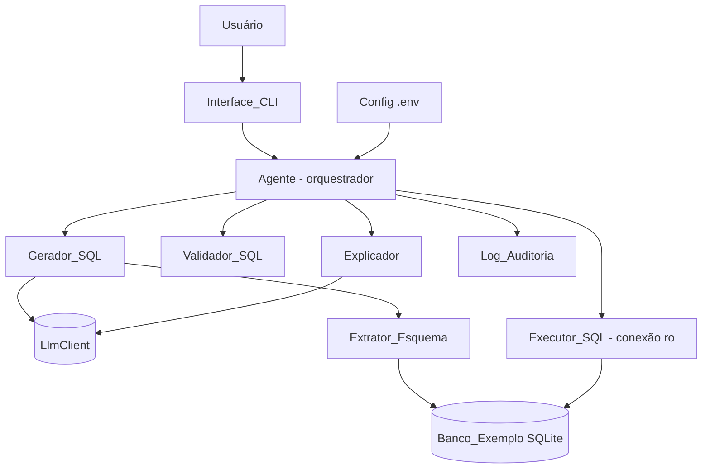
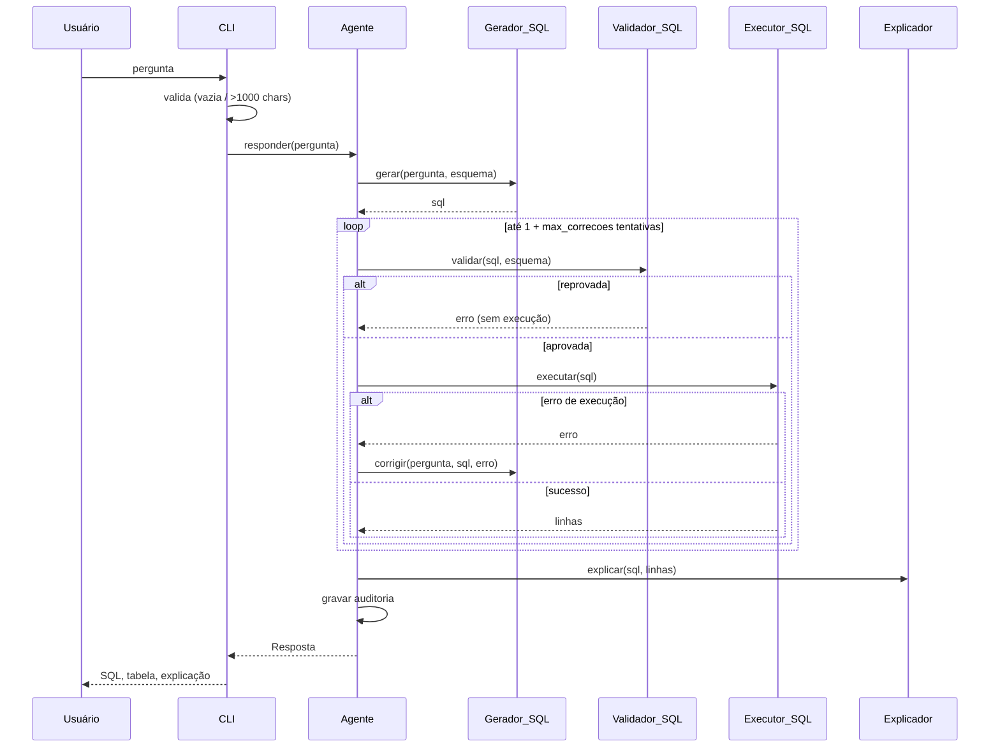
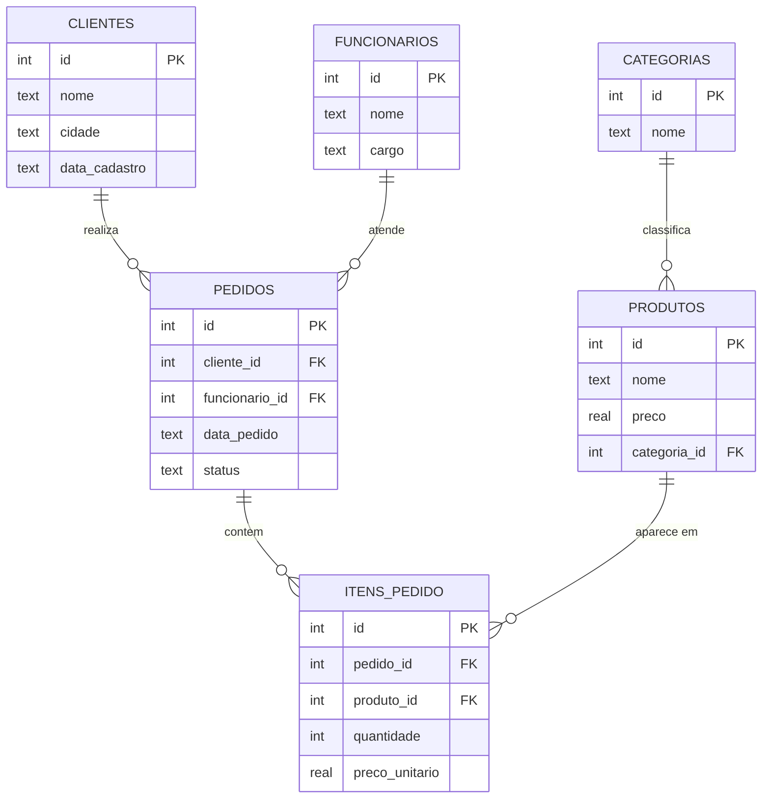

# Documento de Design

## Overview

O Agente Text-to-SQL recebe uma pergunta em português pela CLI, gera uma consulta SQLite com um LLM, valida a consulta (somente leitura), executa em uma conexão somente leitura, tenta autocorrigir erros e devolve tabela de resultados e explicação em português. Cada interação é gravada em um log de auditoria.

Decisões principais:

| Decisão | Escolha | Justificativa |
|---|---|---|
| Linguagem | Python 3.11+ | Ecossistema de LLM e `sqlite3` na biblioteca padrão |
| Banco | SQLite | Sem servidor, reproduzível; abre em modo `mode=ro` via URI |
| Validação de SQL | `sqlglot` (dialeto SQLite) + checagem de palavras-chave | Parser real evita falsos positivos de regex (ex.: palavra `DELETE` dentro de string literal) e permite extrair tabelas e colunas referenciadas |
| LLM | Interface `LlmClient` com adaptador para API HTTP (ex.: OpenAI ou Anthropic via SDK) | Troca de provedor sem alterar o núcleo; testes usam um cliente falso |
| CLI | `argparse` + `input()` em laço, tabelas com `tabulate` | Dependências mínimas |
| Configuração | `python-dotenv` + `os.environ` | Variável de ambiente do processo tem precedência sobre `.env` (Req. 8.2) |
| Testes | `pytest` + `hypothesis` | Biblioteca de PBT madura para Python; não se implementa PBT do zero |

Pesquisa: o parâmetro `mode=ro` em URI do `sqlite3` (`sqlite3.connect("file:db.sqlite?mode=ro", uri=True)`) abre o arquivo somente para leitura e faz qualquer escrita falhar com `OperationalError` ([documentação do sqlite3](https://docs.python.org/3/library/sqlite3.html)). O tempo limite de execução pode ser imposto com `Connection.set_progress_handler`, que permite abortar a consulta ao retornar valor diferente de zero. Conteúdo parafraseado das documentações oficiais.

## Architecture

Arquitetura em camadas simples. O orquestrador (`Agente`) depende de interfaces; os componentes concretos são injetados, o que permite testar sem rede.



Fluxo por pergunta:



Estrutura de pacotes:

```
sql_agent/
  config.py        # Config, carregamento e validação
  schema.py        # Extrator_Esquema, SchemaInfo
  llm.py           # LlmClient (Protocol) + adaptador de API
  generator.py     # Gerador_SQL, montagem do prompt, extract_sql
  validator.py     # Validador_SQL
  executor.py      # Executor_SQL
  explainer.py     # Explicador
  audit.py         # Log_Auditoria
  agent.py         # Agente (orquestração, autocorreção)
  cli.py           # Interface_CLI
  evaluation.py    # comparação de resultados e script de avaliação
db/
  create_db.py     # script idempotente de criação do Banco_Exemplo
  schema_descriptions.yaml  # descrições opcionais de colunas
  few_shot.yaml    # até 10 exemplos
eval/dataset.yaml  # Conjunto_Avaliação
docs/ images/ tests/ README.md LICENSE .env.example .gitignore
```

## Components and Interfaces

### Config
```python
@dataclass(frozen=True)
class Config:
    api_key: str            # LLM_API_KEY (obrigatória)
    model: str              # LLM_MODEL (obrigatório)
    db_path: str            # DB_PATH
    max_correcoes: int      # MAX_CORRECOES, padrão 3, válido 1..10
    max_linhas: int         # MAX_LINHAS, padrão 100, válido 1..10000
    timeout_consulta_s: int # QUERY_TIMEOUT_S, padrão 10, válido 1..300
    audit_path: str
    avisos: list[str]       # valores inválidos ignorados
def carregar_config(env: Mapping[str, str], dotenv: Mapping[str, str]) -> Config
```
`env` sobrepõe `dotenv`. Chave ausente, vazia ou só com espaços lança `ConfigError("LLM_API_KEY")`; modelo ausente lança `ConfigError("LLM_MODEL")`. Valores numéricos fora da faixa ou não inteiros usam o padrão e adicionam um aviso (Req. 5.3). A chave nunca é incluída em `repr`, mensagens ou log (campo `field(repr=False)` e função `mascarar`).

### Extrator_Esquema
```python
@dataclass
class Coluna: nome; tipo; pk: bool; fk: tuple[str,str] | None; descricao: str | None
@dataclass
class Tabela: nome; colunas: list[Coluna]
@dataclass
class SchemaInfo: tabelas: list[Tabela]; avisos: list[str]
    def para_prompt(self) -> str
def extrair_esquema(conn, descricoes: dict) -> SchemaInfo
```
Usa `sqlite_master`, `PRAGMA table_info` e `PRAGMA foreign_key_list`, excluindo tabelas `sqlite_%`. Descrições truncadas em 500 caracteres; descrições de tabela ou coluna inexistente geram aviso e são ignoradas. A leitura roda com limite de 10 s; falha encerra o processo com código diferente de zero.

### LlmClient
```python
class LlmClient(Protocol):
    def completar(self, system: str, user: str, timeout_s: float) -> str
class LlmTimeout(Exception); class LlmRedeError(Exception); class LlmLimiteError(Exception)
```

### Gerador_SQL
```python
def gerar(pergunta: str) -> str                     # chama o LLM
def corrigir(pergunta: str, sql: str, erro: str) -> str
def extract_sql(resposta: str) -> str               # função pura
def format_sql_block(sql: str) -> str               # função pura (apoia a propriedade de ida e volta)
```
O prompt de sistema contém: o esquema completo, instrução de responder somente com SQL SQLite, regra de somente leitura, até 10 exemplos few-shot e a instrução de responder `NAO_DISPONIVEL` se os dados não existirem no esquema (Req. 3.6).

`extract_sql`:
1. Se houver bloco com três crases (com ou sem `sql`), usa o conteúdo do bloco; senão usa o texto inteiro.
2. Remove espaços nas pontas.
3. Resposta vazia ou sem SELECT/WITH reconhecível: `GeracaoError("falha na geração")`.
4. Mais de uma instrução (via `sqlglot.parse`, ignorando `;` final isolado): `GeracaoError("mais de uma instrução")`.

### Validador_SQL
```python
@dataclass
class ResultadoValidacao: aprovada: bool; motivo: str | None; palavra_chave: str | None
def validar(sql: str, esquema: SchemaInfo) -> ResultadoValidacao
```
Passos, em ordem:
1. Remove comentários e espaços; tokeniza com `sqlglot` (dialeto SQLite). Falha de parse rejeita.
2. Mais de uma instrução: rejeita com "somente uma instrução por consulta".
3. A instrução deve ser `SELECT`/`WITH ... SELECT`. Percorre a AST procurando nós de escrita/definição (INSERT, UPDATE, DELETE, REPLACE, DROP, ALTER, CREATE, ATTACH, DETACH, VACUUM, PRAGMA); informa a palavra-chave detectada. Palavras dentro de literais de texto não contam.
4. Coleta tabelas (excluindo CTEs declaradas) e colunas qualificadas ou não; tabela ou coluna inexistente no esquema rejeita informando o nome (Req. 4.5). Aliases e colunas de subconsultas e CTEs são resolvidos antes da checagem.

A validação é pura e rápida (meta de 500 ms). A defesa em profundidade é a conexão `mode=ro` do Executor.

### Executor_SQL
```python
@dataclass
class ResultadoExecucao: colunas: list[str]; linhas: list[tuple]; truncado: bool; limite: int
def executar(sql: str) -> ResultadoExecucao
class ErroExecucao(Exception); class TempoExcedido(Exception); class ErroAcessoBanco(Exception)
```
- Conexão `file:{db_path}?mode=ro` com `uri=True`; falha ao abrir gera `ErroAcessoBanco`, sem fallback para escrita.
- Usa `fetchmany(max_linhas + 1)`: se vierem mais que `max_linhas`, descarta o excedente e marca `truncado=True`. Nenhum resultado parcial é devolvido em erro.
- `set_progress_handler` interrompe a consulta ao passar `timeout_consulta_s`, levantando `TempoExcedido`.

### Explicador
```python
def explicar(pergunta, sql, resultado) -> str
```
Chama o LLM com timeout de 15 s e pede descrição da consulta e resumo com o número de linhas. O texto é limitado a 1.000 caracteres. Em falha ou timeout o Agente usa `None` e a CLI exibe "explicação não disponível".

### Log_Auditoria
```python
def gravar(reg: RegistroAuditoria) -> None   # JSON Lines, timeout lógico de 2 s
def truncar(texto: str, limite: int) -> tuple[str, bool]
```
Arquivo JSON Lines, um registro por pergunta. A gravação roda em thread com `join(2)`; em falha ou excesso de tempo retorna `False` e a CLI avisa que a interação não foi auditada, sem retentar.

### Agente
```python
def responder(pergunta: str) -> Resposta
```
Orquestra gerar, validar, executar e corrigir (até `max_correcoes` correções, contando só os envios ao LLM). Rejeição pelo Validador não aciona autocorreção: encerra com falha e mensagem. Erros de rede ou limite de requisições interrompem as tentativas. `Resposta` traz `sql`, `resultado`, `explicacao`, `erro`, `etapa_falha`, `tentativas`, `status`.

### Interface_CLI
Laço de leitura: ignora vazia (mensagem), rejeita acima de 1.000 caracteres sem chamar o LLM, comando `sair` encerra com código 0. Exibe SQL, tabela (`tabulate`), aviso de truncamento, explicação e avisos. Toda exceção de domínio é capturada por pergunta, mantendo a sessão ativa.

### Avaliação
```python
def comparar_resultados(gerado, esperado, ordenado: bool) -> bool
def avaliar(dataset, agente) -> RelatorioAvaliacao   # acertos, total, taxa (1 casa), falhas
```
`ordenado` é verdadeiro quando a SQL esperada contém `ORDER BY`; caso contrário compara multiconjuntos de linhas. Falhas por par são registradas e a avaliação continua (timeout de 30 s por par).

## Data Models

**Banco_Exemplo** (domínio de loja, 5 tabelas, ≥ 10 linhas cada, ≥ 100 no total):



`create_db.py` roda em uma transação única: cria um arquivo temporário, popula e substitui o arquivo final com `os.replace`. Isso garante idempotência (mesmo estado ao reexecutar) e ausência de dados parciais em caso de falha, com código de saída diferente de zero e mensagem do passo que falhou.

**RegistroAuditoria** (JSON Lines):
```json
{"timestamp_utc": "2025-01-01T12:00:00Z", "pergunta": "...", "pergunta_truncada": false,
 "sql": "...", "sql_truncada": false, "validacao": "aprovada|reprovada",
 "motivo_reprovacao": null, "tentativas": 1, "status": "sucesso|falha"}
```
Limites: pergunta 4.000 e SQL 10.000 caracteres; sem SQL gerada, `sql` é vazio e `status` é `falha`.

**Conjunto_Avaliação** (`eval/dataset.yaml`): lista de `{pergunta, sql_esperada, categoria}` com categorias `filtros`, `agregacoes`, `juncoes`, `ordenacao`, `agrupamento` (≥ 15 pares, ≥ 2 por categoria).

**Few-shot** (`db/few_shot.yaml`): até 10 pares `{pergunta, sql}`.

## Correctness Properties

*A property is a characteristic or behavior that should hold true across all valid executions of a system-essentially, a formal statement about what the system should do. Properties serve as the bridge between human-readable specifications and machine-verifiable correctness guarantees.*

Reflexão sobre redundâncias: 1.2 e 1.5 viraram uma só propriedade de entrada inválida; 2.2, 2.3 e 3.7 viraram uma propriedade sobre o conteúdo do prompt; 3.3 e 9.6 são a mesma ida e volta; 5.1, 5.2, 5.4 e 5.5 foram unificados em uma propriedade de autocorreção; 6.3 e 6.4 e também 9.3 e 9.4 foram unificados; 10.1 e 10.3 foram unificados. Critérios de LLM real, infraestrutura, desempenho e documentação ficam com testes de exemplo, de fumaça ou de integração.

### Property 1: Entrada inválida é rejeitada sem acionar o LLM

*For any* pergunta composta apenas de espaços (incluindo vazia) ou com mais de 1.000 caracteres, a CLI deve rejeitar a entrada com mensagem, sem nenhuma chamada ao LLM, e manter a sessão ativa; perguntas válidas de até 1.000 caracteres devem ser aceitas.

**Validates: Requirements 1.2, 1.5**

### Property 2: Falhas por pergunta não encerram a sessão

*For any* tipo de falha (timeout do LLM, erro de rede, limite de requisições, SQL rejeitada, erro de execução) em uma pergunta, o Agente deve devolver uma resposta de erro que identifica a etapa, sem linhas parciais, e a pergunta seguinte deve ser processada normalmente.

**Validates: Requirements 1.6, 4.7, 5.6**

### Property 3: Extração de esquema é completa e fiel

*For any* esquema SQLite gerado (tabelas, colunas, tipos, chaves primárias e estrangeiras), o esquema extraído deve conter todas as tabelas de usuário e, para cada uma, todas as colunas com tipo, indicação de chave primária e destino de chave estrangeira iguais aos da definição de origem, e nenhuma tabela `sqlite_*`.

**Validates: Requirements 2.1**

### Property 4: O prompt contém todo o contexto configurado

*For any* esquema, conjunto de descrições válidas e lista de 0 a 10 exemplos few-shot, o prompt montado deve conter todos os nomes de tabelas e colunas, cada descrição associada (truncada em 500 caracteres) e todos os exemplos configurados.

**Validates: Requirements 2.2, 2.3, 3.7**

### Property 5: Descrições de itens inexistentes são ignoradas com aviso

*For any* esquema e conjunto de descrições que referenciam tabelas ou colunas inexistentes, o esquema resultante deve ser igual ao obtido sem essas descrições, com um aviso identificando cada item não encontrado.

**Validates: Requirements 2.4**

### Property 6: Extração de SQL de bloco Markdown é inversa da formatação

*For any* consulta de leitura válida, formatá-la em um bloco de código Markdown (com ou sem o identificador `sql`, com variações de espaços e quebras de linha ao redor) e extraí-la novamente deve produzir a consulta original sem espaços nas pontas.

**Validates: Requirements 3.3, 9.6**

### Property 7: Respostas sem SQL única são rejeitadas

*For any* resposta do LLM vazia, sem instrução SELECT/WITH reconhecível ou com duas ou mais instruções, a extração deve levantar erro de geração e nenhuma consulta deve ser executada no banco; um `;` final isolado não conta como segunda instrução.

**Validates: Requirements 3.4, 3.5**

### Property 8: Consultas de leitura válidas são aprovadas

*For any* consulta SELECT ou WITH...SELECT sobre tabelas e colunas existentes no esquema, com qualquer combinação de maiúsculas e minúsculas, espaços e comentários, e inclusive com palavras como DELETE ou DROP dentro de literais de texto, o Validador deve aprovar a consulta.

**Validates: Requirements 3.1, 4.1**

### Property 9: Instruções de escrita ou definição são rejeitadas

*For any* instrução que contenha INSERT, UPDATE, DELETE, REPLACE, DROP, ALTER, CREATE, ATTACH, DETACH, VACUUM ou PRAGMA de escrita, em qualquer combinação de maiúsculas e minúsculas, o Validador deve rejeitar a consulta, informar a palavra-chave detectada, e o Executor não deve ser chamado.

**Validates: Requirements 4.2, 4.6**

### Property 10: Múltiplas instruções são rejeitadas

*For any* sequência de duas ou mais consultas separadas por ponto e vírgula, o Validador deve rejeitar a consulta indicando que só uma instrução é permitida, enquanto a mesma consulta única com um `;` final isolado deve ser aprovada.

**Validates: Requirements 4.3**

### Property 11: Referências inexistentes ao esquema são rejeitadas

*For any* consulta de leitura que referencie uma tabela ou coluna ausente do esquema, o Validador deve rejeitá-la antes da execução com mensagem contendo o nome não encontrado.

**Validates: Requirements 4.5**

### Property 12: Autocorreção respeita o limite e para no primeiro sucesso

*For any* limite N entre 1 e 10 e qualquer sequência de resultados de execução, o Agente deve enviar ao LLM no máximo N pedidos de correção, cada um contendo a pergunta, a consulta com falha e a mensagem de erro; se a execução tiver sucesso após k falhas (k ≤ N), devem ocorrer exatamente k correções e o resultado da consulta corrigida deve ser devolvido; se as N correções se esgotarem, a resposta deve conter o último erro do Executor.

**Validates: Requirements 5.1, 5.2, 5.4, 5.5**

### Property 13: Configuração numérica inválida usa o padrão

*For any* valor de configuração que não seja um inteiro dentro da faixa permitida (1 a 10 para correções, 1 a 10.000 para linhas, 1 a 300 para tempo limite), a configuração deve usar o valor padrão (3, 100 e 10) e registrar um aviso de que o valor foi ignorado; valores válidos devem ser mantidos.

**Validates: Requirements 5.3, 6.3, 6.5**

### Property 14: Renderização de tabela preserva colunas e linhas

*For any* resultado com uma ou mais linhas, a saída renderizada deve conter o cabeçalho com os nomes das colunas na ordem retornada e uma linha para cada registro.

**Validates: Requirements 6.1**

### Property 15: Limite de exibição e aviso de truncamento

*For any* tabela com n linhas e limite L válido, o Executor deve devolver min(n, L) linhas, `truncado` deve ser verdadeiro exatamente quando n > L e, nesse caso, a mensagem exibida deve conter o valor de L.

**Validates: Requirements 6.3, 6.4**

### Property 16: Variável de ambiente prevalece sobre o `.env`

*For any* variável definida simultaneamente no ambiente do processo e no `.env` com valores diferentes, a configuração carregada deve usar o valor do ambiente do processo.

**Validates: Requirements 8.2**

### Property 17: Chave de API ausente ou em branco impede a inicialização

*For any* valor de chave de API ausente, vazio ou composto apenas de espaços, o carregamento da configuração deve levantar erro cuja mensagem contém o nome `LLM_API_KEY`, sem chamar o LLM nem abrir o banco.

**Validates: Requirements 8.4**

### Property 18: A chave de API nunca aparece nas saídas

*For any* chave de API configurada, a representação textual da configuração, as mensagens de erro exibidas e os registros do Log_Auditoria não devem conter o valor da chave.

**Validates: Requirements 8.6**

### Property 19: Comparação de resultados na avaliação

*For any* par de conjuntos de linhas, a comparação sem ORDER BY deve considerá-los iguais exatamente quando forem o mesmo multiconjunto (qualquer permutação das linhas é igual), e com ORDER BY somente quando forem iguais na mesma ordem.

**Validates: Requirements 9.2**

### Property 20: Relatório de avaliação é consistente e resiliente a falhas

*For any* lista de pares com desfechos arbitrários (acerto, SQL errada, erro do LLM, rejeição, erro de execução, tempo excedido), a avaliação deve processar todos os pares, o total deve ser igual ao número de pares, a taxa deve ser acertos dividido pelo total em percentual com 1 casa decimal, e cada falha deve ser listada com pergunta, SQL gerada e motivo.

**Validates: Requirements 9.2, 9.3, 9.4**

### Property 21: Uma pergunta gera exatamente um registro de auditoria

*For any* pergunta processada e qualquer desfecho (sucesso, falha, SQL não gerada), o log deve receber exatamente um novo registro com todos os campos exigidos, timestamp UTC com precisão de segundos e número de tentativas entre 1 e 3; sem SQL gerada, o campo `sql` deve ser vazio e o status `falha`.

**Validates: Requirements 10.1, 10.3**

### Property 22: Truncamento de textos respeita os limites e sinaliza

*For any* texto e limite, `truncar` deve devolver um texto de no máximo o limite, igual ao original quando este não o excede, com marca de truncado verdadeira exatamente quando o original excede o limite; isso vale para pergunta (4.000), SQL (10.000) e explicação (1.000).

**Validates: Requirements 1.1, 10.2**

## Error Handling

| Situação | Detecção | Comportamento |
|---|---|---|
| Chave ou modelo ausentes | `carregar_config` | Mensagem com o nome da variável, saída com código ≠ 0 em até 2 s, sem chamar LLM nem banco |
| Banco inacessível ou esquema lento (> 10 s) | `extrair_esquema` | Mensagem com o motivo, não aceita perguntas, código ≠ 0 |
| Pergunta vazia ou > 1.000 caracteres | CLI | Mensagem, sem LLM, sessão ativa |
| Timeout, rede ou limite do LLM | `LlmTimeout`, `LlmRedeError`, `LlmLimiteError` | Mensagem com causa e etapa, sem linhas parciais, sessão ativa |
| Resposta sem SQL ou com várias instruções | `GeracaoError` | Mensagem de falha na geração, sem execução |
| Dados não disponíveis (`NAO_DISPONIVEL`) | Agente | Mensagem informando ausência de dados, sem execução |
| SQL reprovada (escrita, múltiplas instruções, nome inexistente) | `ResultadoValidacao` | Mensagem com a palavra-chave ou nome, sem execução e sem autocorreção |
| Erro de execução | `ErroExecucao` | Autocorreção até N vezes; esgotado, mostra o último erro |
| Consulta além do tempo limite | `TempoExcedido` | Interrompe, informa o limite, sem resultado parcial |
| Falha ao abrir conexão `ro` | `ErroAcessoBanco` | Mensagem de falha de acesso, sem fallback de escrita |
| Falha do Explicador (> 15 s) | exceção ou timeout | Exibe tabela e "explicação não disponível" |
| Falha de gravação da auditoria (> 2 s) | `gravar` retorna `False` | Aviso "interação não auditada", resposta intacta, sem nova tentativa |
| Falha em `create_db.py` | exceção na transação | Código ≠ 0, mensagem do passo, arquivo final intacto ou inexistente |

Toda exceção é capturada no laço da CLI por pergunta; mensagens passam por `mascarar` para nunca expor a chave.

## Testing Strategy

Abordagem dupla: testes de exemplo e de propriedade, complementares. Nenhum teste automatizado chama a API real ou a rede; usa-se `LlmClient` falso e SQLite em memória ou temporário.

**Testes de propriedade** (`hypothesis`, biblioteca de PBT para Python; não se implementa PBT do zero):
- Cada uma das propriedades 1 a 22 é implementada por um único teste de propriedade.
- Mínimo de 100 iterações por teste (`@settings(max_examples=100)`); a propriedade 6 usa pelo menos 100 consultas por execução.
- Cada teste traz o comentário `Feature: text-to-sql-agent, Property {n}: {texto da propriedade}`.
- Geradores: esquemas SQLite aleatórios, consultas de leitura construídas por estratégia sobre o esquema, instruções de escrita em caixa mista, strings de espaços e textos longos, sequências de resultados de execução e desfechos de avaliação.

**Testes de exemplo e de borda:**
- Fluxo completo da pergunta com LLM falso (Req. 1.1), comando `sair` com código 0 (1.3), várias perguntas por sessão (1.4).
- Banco inacessível (2.5, 4.8), tentativa de escrita pela conexão `ro` com hash do arquivo antes e depois (4.4, 4.7), pergunta de prompt injection com cliente falso que devolve `DROP` (4.6).
- Instrução `NAO_DISPONIVEL` (3.6), erros de rede e limite durante a correção (5.6), zero linhas (6.2), consulta lenta com limite de 1 s (6.5), falha do Explicador (6.7), falha de gravação da auditoria (10.5), medição de 2 s (10.4).
- `create_db.py`: execução dupla com comparação de tabelas, chaves e contagens (7.3); falha injetada sem dados parciais (7.4).

**Testes de fumaça:** contagem de tabelas, FKs e linhas do banco de exemplo (7.1, 7.2), `.env.example` listando todas as variáveis lidas e `.gitignore` com `.env` (8.3), Conjunto_Avaliação com ≥ 15 pares e ≥ 2 por categoria (9.1), existência do README com as 9 seções, dos 5 temas em `/docs`, de ≥ 3 imagens referenciadas com caminho válido, de LICENSE e de exemplos e resultados no README (11.1 a 11.5, 11.7, 11.8). A visibilidade pública do repositório (11.6) é verificada manualmente.

**Avaliação com LLM real:** o script `evaluation.py` roda sob demanda (exige API) e produz os números do README; fica fora da suíte automatizada. Os testes automatizados do Validador, do Extrator_Esquema e da extração de SQL incluem casos de sucesso e falha e pelo menos uma rejeição de INSERT, UPDATE, DELETE e DROP (9.5).
