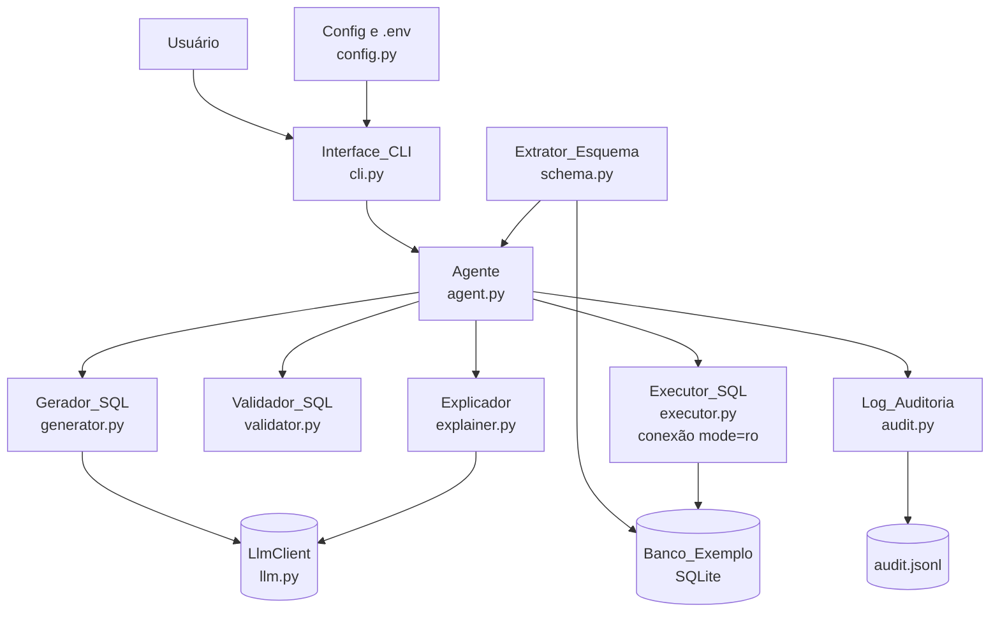

# Arquitetura

O sistema é um pacote Python (`sql_agent/`) em camadas simples. O `Agente` orquestra componentes que recebem suas dependências por injeção (`LlmClient`, `ExecutorSql`, `SchemaInfo`, `Config`). Isso permite testar tudo com um cliente LLM falso, sem rede.

## Diagrama de componentes



## Componentes

| Módulo | Responsabilidade |
|---|---|
| `config.py` | `Config` imutável, `carregar_config` (ambiente prevalece sobre `.env`), padrões e avisos para valores numéricos inválidos, `mascarar` para ocultar a chave de API |
| `schema.py` | `extrair_esquema` lê tabelas, colunas, tipos, PKs e FKs com `sqlite_master` e `PRAGMA`; anexa descrições de `db/schema_descriptions.yaml`; `SchemaInfo.para_prompt` gera o texto do esquema |
| `llm.py` | `Protocol` `LlmClient`, exceções `LlmTimeout`, `LlmRedeError`, `LlmLimiteError` e `HttpLlmClient` (chat completions via `urllib`) |
| `generator.py` | Monta o prompt, chama o LLM (`gerar`, `corrigir`) e extrai a SQL (`extract_sql`) |
| `validator.py` | `validar(sql, esquema)` com `sqlglot` (dialeto SQLite): uma instrução, somente leitura, tabelas e colunas existentes |
| `executor.py` | `ExecutorSql.executar`: conexão `mode=ro`, limite de linhas e tempo limite |
| `explainer.py` | `explicar`: descrição da consulta e resumo do resultado em até 1.000 caracteres, com timeout de 15 s |
| `audit.py` | `gravar`: um registro JSON Lines por pergunta, com limite de 2 s |
| `agent.py` | `Agente.responder`: gerar, validar, executar, autocorrigir, explicar, auditar |
| `cli.py` | Laço de leitura, validação da entrada, exibição de SQL, tabela e explicação |
| `evaluation.py` | `comparar_resultados`, `avaliar` e ponto de entrada `python -m sql_agent.evaluation` |

Arquivos de apoio: `db/create_db.py` (cria o banco), `db/schema_descriptions.yaml`, `db/few_shot.yaml` (até 10 exemplos) e `eval/dataset.yaml` (conjunto de avaliação).

## Princípios

- **Dependências por interface.** O núcleo depende do `Protocol` `LlmClient`. Trocar de provedor exige só um novo adaptador.
- **Defesa em profundidade.** O validador bloqueia SQL de escrita antes da execução e o executor abre o banco em `mode=ro`, de modo que uma falha do validador ainda não permite alterar dados. Detalhes em [decisões de segurança](decisoes-de-seguranca.md).
- **Falhas isoladas por pergunta.** Qualquer exceção é tratada no `Agente` e na CLI. A sessão continua ativa.
- **Auditoria completa.** Cada pergunta gera exatamente um registro, inclusive nas falhas.

## Modelo de dados do log de auditoria

Cada linha de `audit.jsonl`:

```json
{"timestamp_utc": "2025-01-01T12:00:00Z", "pergunta": "...", "pergunta_truncada": false,
 "sql": "...", "sql_truncada": false, "validacao": "aprovada", "motivo_reprovacao": null,
 "tentativas": 1, "status": "sucesso"}
```

Pergunta limitada a 4.000 caracteres e SQL a 10.000, com as marcas `*_truncada`. `tentativas` é 1 mais o número de correções enviadas ao LLM, limitado a 3 no registro. A avaliação grava em `audit_avaliacao.jsonl`, separado do log da CLI.
