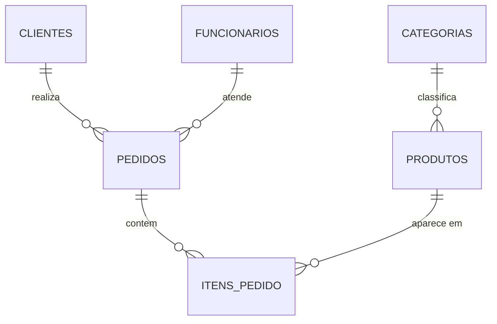

# Esquema do Banco_Exemplo

Banco SQLite de uma loja, criado por `python db/create_db.py` (arquivo padrão `db/loja.sqlite`). Tem 6 tabelas e 145 linhas: categorias 10, produtos 20, clientes 15, funcionarios 10, pedidos 30 e itens_pedido 60. Os dados são determinísticos e o script é idempotente: monta um arquivo temporário em uma transação e o substitui com `os.replace`, sem deixar dados parciais em caso de falha.

## Diagrama ER



## ER em texto

Notação: `1` = exatamente um, `0..N` = zero ou mais.

```text
categorias   (1) ----< (0..N) produtos       produtos.categoria_id    -> categorias.id
clientes     (1) ----< (0..N) pedidos        pedidos.cliente_id       -> clientes.id
funcionarios (1) ----< (0..N) pedidos        pedidos.funcionario_id   -> funcionarios.id
pedidos      (1) ----< (0..N) itens_pedido   itens_pedido.pedido_id   -> pedidos.id
produtos     (1) ----< (0..N) itens_pedido   itens_pedido.produto_id  -> produtos.id
```

Em cada relação, o lado "1" é obrigatório do ponto de vista do lado "N": as colunas de chave estrangeira são `NOT NULL`. Um pedido pertence a exatamente um cliente e é atendido por exatamente um funcionário. `itens_pedido` é a tabela associativa entre `pedidos` e `produtos` (relação N:N), com `quantidade` e `preco_unitario`.

## Tabelas

### categorias

| Coluna | Tipo | Restrições |
|---|---|---|
| id | INTEGER | PK |
| nome | TEXT | NOT NULL |

### produtos

| Coluna | Tipo | Restrições |
|---|---|---|
| id | INTEGER | PK |
| nome | TEXT | NOT NULL |
| preco | REAL | NOT NULL |
| categoria_id | INTEGER | NOT NULL, FK -> categorias(id) |

### clientes

| Coluna | Tipo | Restrições |
|---|---|---|
| id | INTEGER | PK |
| nome | TEXT | NOT NULL |
| cidade | TEXT | NOT NULL |
| data_cadastro | TEXT | NOT NULL, formato AAAA-MM-DD |

### funcionarios

| Coluna | Tipo | Restrições |
|---|---|---|
| id | INTEGER | PK |
| nome | TEXT | NOT NULL |
| cargo | TEXT | NOT NULL |

### pedidos

| Coluna | Tipo | Restrições |
|---|---|---|
| id | INTEGER | PK |
| cliente_id | INTEGER | NOT NULL, FK -> clientes(id) |
| funcionario_id | INTEGER | NOT NULL, FK -> funcionarios(id) |
| data_pedido | TEXT | NOT NULL, formato AAAA-MM-DD |
| status | TEXT | NOT NULL (`entregue`, `enviado`, `pendente` ou `cancelado`) |

### itens_pedido

| Coluna | Tipo | Restrições |
|---|---|---|
| id | INTEGER | PK |
| pedido_id | INTEGER | NOT NULL, FK -> pedidos(id) |
| produto_id | INTEGER | NOT NULL, FK -> produtos(id) |
| quantidade | INTEGER | NOT NULL |
| preco_unitario | REAL | NOT NULL |

O valor de um item é `quantidade * preco_unitario`. O valor de um pedido é a soma dos seus itens.

As descrições de coluna usadas no prompt estão em `db/schema_descriptions.yaml`.
