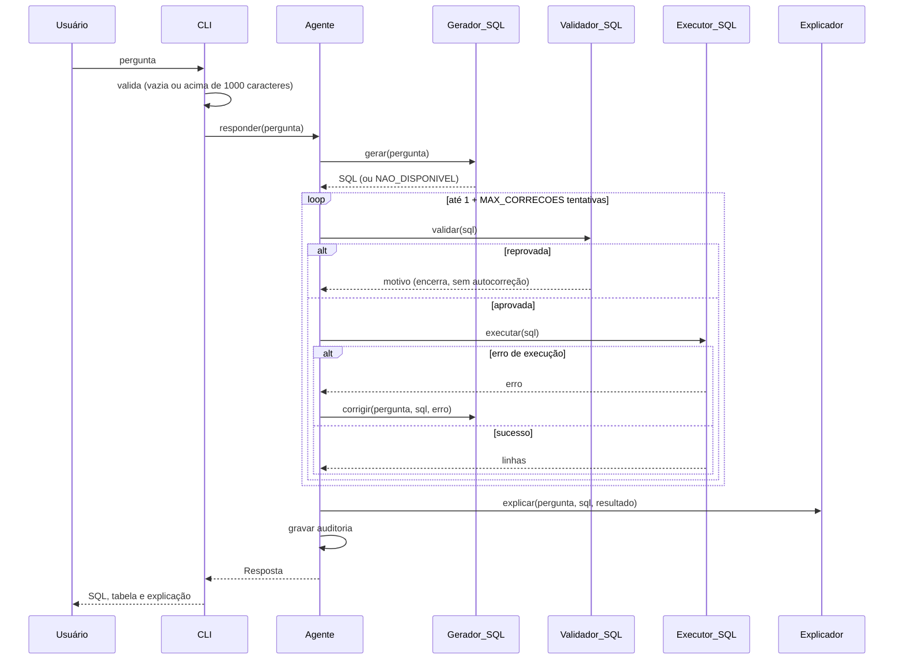

# Fluxo do Agente

## Visão geral

## Passos

1. **Entrada.** A CLI rejeita entrada vazia (ou só espaços) e entrada com mais de 1.000 caracteres, sem chamar o LLM. O comando `sair` encerra com código 0.
2. **Geração.** `generator.gerar` envia ao LLM o prompt de sistema (esquema, regras, exemplos) e a pergunta. `extract_sql` extrai a SQL do bloco de código Markdown, se houver.
   - Resposta vazia, sem `SELECT`/`WITH` ou com mais de uma instrução: falha na etapa `geracao`.
   - Resposta `NAO_DISPONIVEL`: o agente informa que os dados não existem no banco e não executa nada (etapa `dados_indisponiveis`).
   - Timeout, rede ou limite de requisições do LLM: falha na etapa `geracao`.
3. **Validação.** `validar` rejeita SQL que não parseia, com mais de uma instrução, que não seja `SELECT`/`WITH`, que contenha nós de escrita ou definição, ou que referencie tabela ou coluna inexistente. A rejeição encerra a pergunta (etapa `validacao`) e não aciona autocorreção.
4. **Execução.** `ExecutorSql.executar` roda a consulta em conexão `mode=ro`. Devolve até `MAX_LINHAS` linhas e marca `truncado` quando há mais. Estourar `QUERY_TIMEOUT_S` interrompe a consulta e falha na etapa `execucao`, sem resultado parcial.
5. **Autocorreção.** Em erro de execução (`ErroExecucao`), o agente chama `corrigir` com a pergunta, a SQL e a mensagem de erro, e volta à validação com a nova SQL. Faz no máximo `MAX_CORRECOES` correções (padrão 3), contando só os envios ao LLM. Esgotadas, devolve o último erro de execução. Erro de rede ou de limite no LLM durante a correção interrompe as tentativas (etapa `correcao`).
6. **Explicação.** Com sucesso, `explicar` pede ao LLM uma descrição da consulta e um resumo com o número de linhas (até 1.000 caracteres, timeout de 15 s). Se falhar, a CLI mostra "explicação não disponível" e mantém a tabela.
7. **Auditoria.** Em qualquer desfecho, grava-se um registro. Se a gravação falhar ou passar de 2 s, a CLI avisa "a interação não foi auditada" e não repete a gravação.
8. **Saída.** A CLI mostra a SQL, a tabela (`tabulate`), o aviso de truncamento quando houver e a explicação. Zero linhas mostra "Nenhum registro encontrado.".

## Estados de falha

| Etapa (`etapa_falha`) | Causa | Autocorreção |
|---|---|---|
| `geracao` | LLM indisponível ou resposta sem SQL única | Não |
| `dados_indisponiveis` | LLM respondeu `NAO_DISPONIVEL` | Não |
| `validacao` | SQL reprovada pelo validador | Não |
| `execucao` | Erro do SQLite esgotou as correções, tempo excedido ou banco inacessível | Só para erro do SQLite, até o limite |
| `correcao` | LLM falhou ou devolveu SQL inutilizável ao corrigir | Não |
| `interna` | Exceção inesperada, tratada para não derrubar a sessão | Não |

Em toda falha, `Resposta.resultado` e `Resposta.explicacao` ficam vazios (sem linhas parciais) e a CLI continua aceitando perguntas.
